# Ally Legal Flex 使用手册

最后更新：2026 年 10 月 22 日

**开发协作说明：** 本版本的功能设计、代码修改及使用手册撰写，由项目维护者与 ChatGPT 协作完成；最终测试与发布前安全审查由 DeepSeek 协助完成。

**项目价值：** 通过 Word 插件，把合同审核和修改融入日常文档工作。用户可以在本机配置和维护自己的审核规则，按需选择、切换后端模型，直接在 Word 中分析合同、检查条款、查看修改建议，并将选定的修改应用到文档中。

**适用人群与使用特点：** 相较于直接与通用聊天 AI 或 Agent 协作，本项目把常用审核步骤整理成 Word 内的固定操作，更适合习惯在 Word 中阅读、批注和修改合同，并希望由自己控制审核标准与每处修改的用户。

- **在 Word 内完成审核与编辑：** 结合当前合同正文提问、查看条款问题和处理修改建议，减少在合同文档与模型聊天窗口之间来回复制内容。
- **合同修改由用户决定：** 生成建议后，由用户核对、选择方案，再通过 Mark-up 应用到选中的条款；生成建议本身不会直接改写合同。需要保留修改痕迹时，先开启 Word 的“修订”。
- **审核规则（Policy）可复用，引用依据可核对：** 用户在本机维护自己的 Policy，按合同需要选择规则集。Summary、Review 会展示所引用的规则集、规则名称和级别，便于追溯到具体审核规则并人工核对。
- **提示词（Prompt）可配置：** 在 **Config → Prompt Settings** 分别查看、编辑 Ask、Summary 和 Review 的核心提示词，查看字数、保存修改或恢复内置提示词。程序自动补充本次合同、适用规则和引用格式要求。

## 目录

- [一、项目背景](#project-background)
- [二、使用所需环境](#setup)
    - [首次启动与桌面入口](#one-click-start)
    - [日常启动与结束](#daily-start-stop)
- [三、使用说明](#usage)
    - [首次配置模型](#model-configuration)
    - [回答语言、审核立场和规则集](#review-settings)
    - [Summary、Ask、Review 与合同修改](#review-features)
    - [建立自己的 Policy 库](#policy-library)
    - [把 Policy 分享给同事或另一台电脑](#policy-sharing)
    - [配置三个功能的提示词](#prompt-settings)

## 一、项目背景

**Ally – AI Contract Assistant** 是微软 Azure Samples 提供的开源合同助手，以 Word 插件的形式运行。使用者可以在 Word 中阅读合同、提问、检查条款和处理修改建议。原项目代码及说明见 [GitHub：Azure-Samples/ally-legal-assistant](https://github.com/Azure-Samples/ally-legal-assistant)。

**原项目权利声明：** 原项目 README 的 [Intellectual Property and Licensing](https://github.com/Azure-Samples/ally-legal-assistant#intellectual-property-and-licensing) 中说明：

> This plugin is free to use and modify by anyone. The GitHub repository is also free to use and change.

**许可来源：** 上游项目的 [`package.json`](https://github.com/Azure-Samples/ally-legal-assistant/blob/main/package.json) 标注许可证为 MIT。本项目基于该项目修改，保留原作者署名及源文件中的版权与许可声明。

**本版本新增及修改部分：** 由 Silvia Shen 在其有权授权的范围内按 [MIT 许可](LICENSE)发布，版权声明为 `Copyright (c) 2026 Silvia Shen`。这项声明仅标识本版本的新增贡献，不替换上游的原作者署名、Microsoft 版权声明或其他既有许可说明。原项目团队署名保留在 [README](README.md#team-behind-ally--ai-contract-assistant) 中。

**第三方组件：** 新增和原有的第三方代码、依赖库及资源分别适用自身的许可证。本项目的 MIT 声明不改变这些组件的版权归属或许可条件。组件来源、许可信息及适用的版权通知见[第三方许可声明](THIRD_PARTY_NOTICES.md)，已收录的许可正文见[许可文件目录](docs/licenses/README.md)。清单说明当前整理范围，后续分发时仍需按实际包含的组件及版本保留对应许可和适用的 NOTICE。

为便于法律从业者使用，本版本以原版 Ally 为基础，新增模型灵活配置、审核规则集管理和审核立场输入，调整规则引用样式，并提供中文回答选项及相应的界面调整。

原版已经提供以下基础功能与界面入口：

| 原有主要功能 | 功能说明 |
| --- | --- |
|  |
| **Summary：合同摘要** | 概括合同的主要条款和关键信息，结合所设置的公司审核规则，帮助快速了解合同内容及潜在问题。 |
| **Ask：合同问答** | 围绕合同提问，检索相关条款，生成回答并展示相关内容供使用者核对。 |
| **Review：条款审核；Mark-up：条款修改** | 根据审核规则检查选中的合同条款，分析与规则不一致的内容。用户从模型提供的三种修改方案中选择，再通过 Mark-up 替换 Word 中的选中条款。 |
| **Policy：审核规则配置** | 允许使用者配置自己的审核规则，包括规则标题、审核要求、级别（Severity）和标签等，作为合同检查和修改建议的依据。 |

原方案采用 Azure OpenAI 生成分析和建议，通过 Azure AI Search 检索合同及审核规则内容，由 PromptFlow 组织处理流程。

### 本次在原项目基础上的修改：

| 主要修改 | 修改说明 |
| --- | --- |
| **自选模型** | 用户可以自己选择所接入的模型。在 **Config → Model Settings** 分别配置支持 OpenAI 兼容接口的 Chat Model 和 Embedding Model，测试连接并保存配置。 |
| **Policy Set 管理** | 支持添加、重命名规则集，并可删除空规则集。用户可按合同类型组织规则，再勾选本次用于 Summary 和 Review 的规则集。 |
| **审核立场** | **Review Perspective** 以“Contract party = Policy party”逐行填写主体对应关系，可添加、删除多组；传给 Ask、Summary 和 Review，作为风险分析和修改建议的参考。 |
| **审核规则引用样式** | Summary、Review 引用规则时，会显示所引规则的规则集、名称和级别，方便核对依据。 |
| **自动合同索引** | 取消前端独立的 Index 操作区。首次使用 Ask、Summary 或 Review 时自动准备本地合同索引；正文或编号变化后，在下次使用功能时更新。Ask 使用索引中的分块检索相关段落，Summary 和 Review 保持各自原有的分析方式。 |

## 二、使用所需环境

准备 Microsoft 365 桌面版 Word、本项目文件，以及模型服务的地址、模型名称和 API Key。首次安装完成后，日常从桌面启动即可。

### 首次使用准备流程图

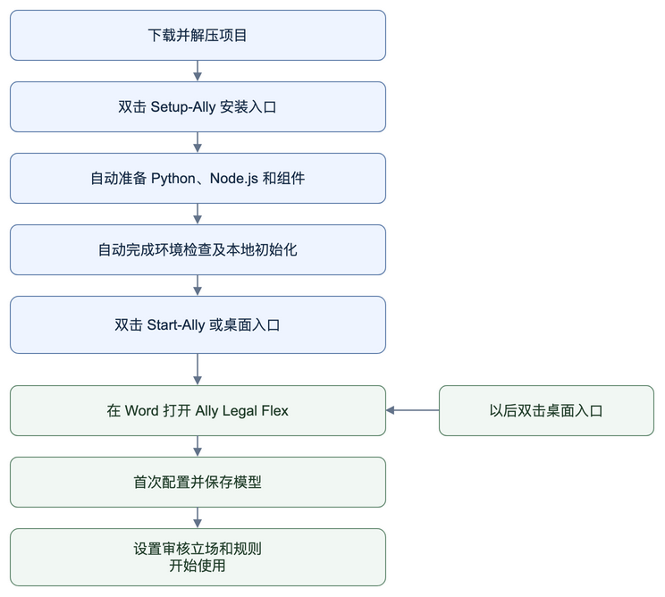

（一）准备 Word 和项目文件

1. 打开桌面版 Word，确认能新建、编辑和保存文档。
2. 在本修改版的 GitHub 仓库页面点击 **Code → Download ZIP**，下载后解压；已有修改版压缩包的直接解压。
3. 将项目放在固定位置，例如 `D:\AllyLegal`（路径尽量短、不含特殊符号）。能看到 `package.json` 和 `backend` 的那一层就是项目主文件夹。创建桌面入口后保留此文件夹的位置。

开源源码 ZIP 保留两组示例规则集、共六条规则，不包含个人 `model_config.json`、API Key、已安装依赖、运行日志或合同缓存。解压后按下列步骤一键安装，首次启动时在 **Config** 填写并保存自己的模型配置。

（二）一键安装

| 系统 | 首次双击安装 | 安装后启动 |
| --- | --- | --- |
| Windows 10 / 11，Intel / AMD 64 位 | `Setup-Ally.cmd` | `Start-Ally.cmd` |
| Mac，Apple Silicon / Intel | `Setup-Ally.command` | `Start-Ally.command` |

1. 完整解压对应系统的安装包，放在固定、可写的文件夹中；不要在压缩包内直接运行。
2. 双击表格中的 **Setup-Ally**。首次需要联网，安装程序会自动下载并校验运行工具、准备项目内的 Python 环境和页面组件，完成本地分析连接初始化并创建桌面入口；如出现系统钥匙串或凭据保存提示，请自行确认。
3. 看到“安装完成”后关闭安装窗口。网络中断时，可以重新双击 Setup 继续；已有的模型、政策和提示词配置会保留。

运行组件保存在项目内的 `.ally-tools`、`.venv` 和 `node_modules`，不需要自行安装 Python 或 Node.js。安装包需要联网准备依赖，并非离线安装包。使用时需要本机桌面版 Word；模型服务由用户自行配置。

如 Mac 提示无法打开安装文件，可按系统提示从“隐私与安全性”允许本次打开。若只提示没有执行权限，在终端输入 `bash `（末尾留空格），将 `Setup-Ally.command` 拖入终端后按回车。开发者也可参考[手动安装](docs/INSTALL_MANUALLY.zh-CN.md)。

（三）首次启动

1. 双击 **Start-Ally** 或桌面 **Ally Legal Flex** 入口，等待服务和 Word 启动。使用期间保留启动窗口。
2. 首次出现本机开发证书提示时，按系统提示安装或信任；Mac 可能需要输入电脑登录密码。Windows 如询问 `Allow localhost loopback for Microsoft Edge WebView?`，输入 `Y` 并按回车。

   该步骤需要管理员权限。如果窗口提示 `Failed to add loopback exemption`，**可以继续使用**：插件仍会载入，只是个别环境下侧边栏可能空白或提示无法连接。遇到这种情况，关闭窗口后右键 `Start-Ally.cmd` → **以管理员身份运行**一次即可；启动器也会在窗口中直接打印可复制的修复命令。
3. 等待“启动完成”，在 Word 打开合同，点击 **开始 / Home → Ally Legal Flex → Ally Legal Flex** 打开审核面板；点击 **Config** 打开配置页。
4. 在 **Config → Model Settings** 配置、测试并保存 Chat Model 和 Embedding Model；另两个标签用于配置政策和三个功能的提示词。

### 日常启动与结束

- **启动：** 双击桌面的 **Windows：Ally Legal Flex / Mac：Ally Legal Flex.command**，等待 Word 打开。具体使用详见第三章“使用说明”。
- **结束：** 保存文档、等待分析完成，回到启动窗口按 **Enter / 回车**。服务停止后关闭启动窗口即可。

首次安装和模型配置通常只需做一次。

## 三、使用说明

首次使用先完成模型配置，之后每次审核检查回答语言、审核立场和适用的规则集，再选择需要的功能。

本章截图展示当前版本的插件面板，使用虚构合同和预设演示数据说明操作，示意输出不代表模型实际审核结论。Word 的入口位置可能因系统和版本不同而变化；可下载[演示合同](docs/examples/Ally-Legal-Flex-demo.docx)练习。

### 使用流程图

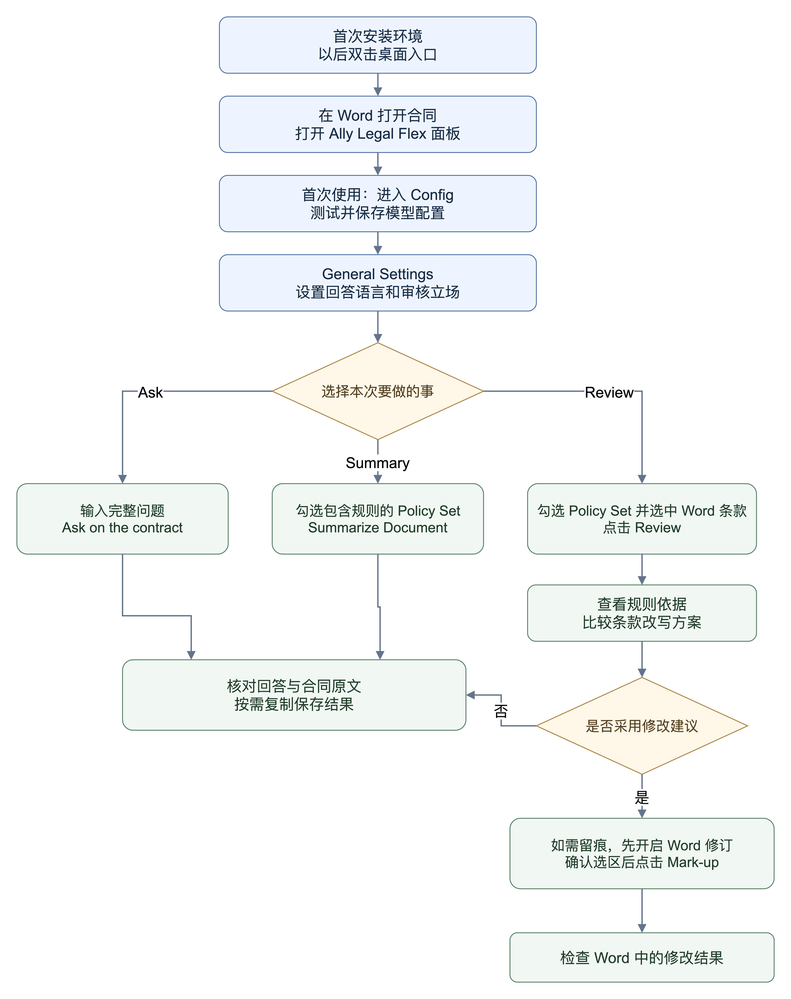

### 1. 先完成一次合同审核

1. 按前面的[双击启动步骤](#one-click-start)操作，在 Word 中打开合同。
2. 在 Word 的 **开始 / Home** 选项卡找到 **Ally Legal Flex** 分组。点击 **Config** 打开配置；点击 **Ally Legal Flex** 打开审核面板。
3. 首次使用时，在 **Config → Model Settings** 配置模型，测试连接并保存，具体见第 2 节。
4. 在审核面板的 **General Settings** 中选择 **Answer Language**，填写 **Review Perspective**（审核立场，例如用户所代表的合同甲方），勾选适用的 **Policy Set**。
5. 点击 **Summarize Document** 查看全文概要；在 **Ask** 中输入问题并点击 **Ask on the contract**，查看合同回答和相关原文。
6. 在 Word 中选中一段完整条款，点击 **Review** 查看规则检查和修改建议。
7. 需要采用修改建议时，先核对建议和 Word 选区，再点击 **Mark-up**。希望保留修改痕迹时，先开启 Word 的“修订”。

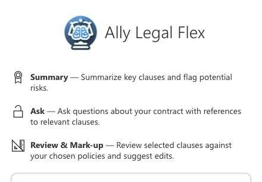

*图 1：审核面板提供 Summary、Ask 和 Review & Mark-up。模型、政策和提示词在 Word 的 Config 入口配置。*

直接点击所需功能即可。程序会自动准备合同索引，已有且与当前合同一致的索引会复用。

### 2. 首次配置模型

打开 **Config → Model Settings**，分别配置以下两类模型。

| 设置 | 用途 | 保存按钮 |
| --- | --- | --- |
| **Chat Model** | 生成 Summary、Ask 和 Review 的回答与建议 | **Apply Model** |
| **Embedding Model** | 检索合同相关段落，以及 Review 所需的相关规则 | **Save Configuration** |

两类设置都需要填写服务商提供的 **API Base URL**、模型名称和 **API Key**。Chat Model 的模型名称字段叫 **Model Name**，Embedding Model 的模型名称字段叫 **Embedding Model**。地址和模型名称以所用服务的说明为准；对话模型与向量模型需要分别配置。

操作顺序：

1. 填写对应模型的地址、名称和密钥。
2. 点击 **Test Connection**，确认连接结果。
3. 点击该模型对应的保存按钮。**测试连接不会保存配置。**
4. 返回审核面板，运行一次功能确认配置可用。

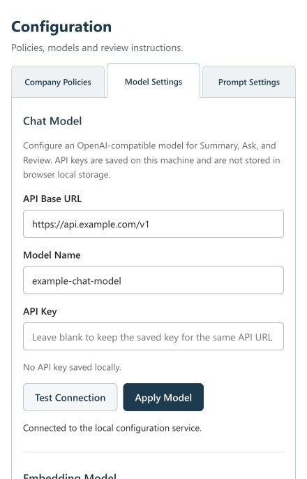

*图 2：填写聊天模型的接口地址、模型名称和密钥，测试后点击 Apply Model 保存。截图不显示已保存的密钥。*

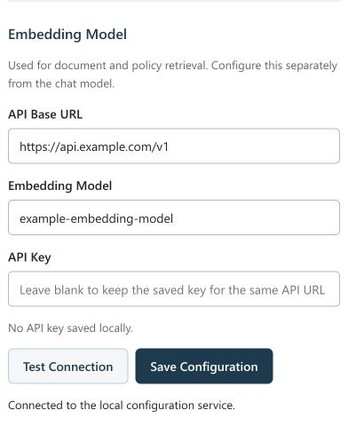

*图 3：向量模型需要单独配置，测试后点击 Save Configuration 保存。*

密钥保存在本机，不会在页面中回显。API 地址不变时，密钥输入框留空表示保留原密钥；更改 API 地址时，保存和测试连接都需要重新填写密钥，防止原密钥被发送到新的地址。

本地运行仍可能调用外部模型服务。模型调用是否收费取决于所配置的服务；开源软件本身免费，不代表模型接口免费。

### 3. 设置回答语言、审核立场和规则集

#### Answer Language：输出使用什么语言

默认是 **Chinese（中文）**，也可以选择 **English** 等语言，插件会记住选择。更改后，需要重新运行功能，已有结果不会自动翻译。

**语言选择也会影响 Review 生成的改写正文。** 审核英文合同、希望保留英文修改稿时，请选择 **English**；选择中文可能生成中文替换方案。Ask 引用的合同原文仍应按原文核对。

#### Review Perspective：代表谁审核

每行分为 **Contract party**（合同中的称呼）和 **Policy party**（政策中的名称或角色）两个输入框，用等号表示同一主体。两侧都支持中文、英文、公司名称或简称。例如：

| 场景 | 填写示例 |
| --- | --- |
| 按合同角色审核 | 左侧填 `甲方`，右侧填 `买方` |
| 按公司名称审核 | 左侧填合同中的公司名称，右侧填政策中对应的名称 |
| 说明角色和公司是同一主体 | 左侧填 `甲方`，右侧填 `ABC 公司` |
| 同时代表两方 | 第一行填 `甲方 = ABC 公司`；点击 **＋ Add mapping**，第二行填 `丙方 = CBD 公司` |
| 英文合同 | 左侧填 `Party A`，右侧填 `Seller`；需要时另加一行 |

点击 **＋ Add mapping** 增加一组对应关系，点击该行的 **×** 删除。只需填写你代表的一方或多方，不必列出全部合同参与方；不需要别名对应时，两侧可填相同称呼，例如 `甲方 = 甲方`。每组需填完整，完全空白的行会忽略；只填一侧时会提示补全或删除该行，不开始请求。多个主体的利益应分别考虑。

留空表示中立分析。明确填写的对应关系（如“甲方 = A公司”）作为本次审核设定；合同名称留空、已脱敏或未写出该简称时，模型仍应采用该映射进行分析。若合同明确记载的名称或角色与设定冲突，应说明冲突并请求澄清。未明确指定且无法从合同识别的身份不应猜测，多方利益冲突时应分别说明。审核设定不会自动补写合同中的空白名称，仍需检查回答是否正确识别了主体。

该立场会传给 **Ask、Summary 和 Review**：事实和原文不应改变，风险分析、关注重点和修改建议会参考所填立场。立场不会自动覆盖你选定的 Policy 要求。

修改或删除已填写的对应关系会让已有结果失效，需要重新运行。当前立场只在本次面板中临时保留，刷新或重新打开面板后恢复一组空白框，请重新检查、填写。

#### Policy Set：这次使用哪些规则

**Policy** 是一条具体审核要求；**Policy Set** 是一组规则，例如“采购合同”“保密协议”或“通用规则”。

- 可以同时勾选多个规则集，只选择与当前合同有关的规则集。
- 初次使用默认不勾选。**Summary 和 Review 至少需要选择一个 Policy Set**；不选时会提示选择，不会自动套用全部规则。
- 新建一个空的 Policy Set 只会创建分组，还需要向其中添加 Policy。运行 Summary 前，请确认每个勾选的规则集都已有规则。
- **Ask 不使用 Policy Set 中的规则**，也不要求勾选规则集。需要按自定义规则检查合同时，使用 Summary 或 Review。

修改规则、选择的 Policy Set、回答语言或合同正文后，请重新运行对应功能。已有结果代表生成时的状态，不会自动完成一次新的审核。

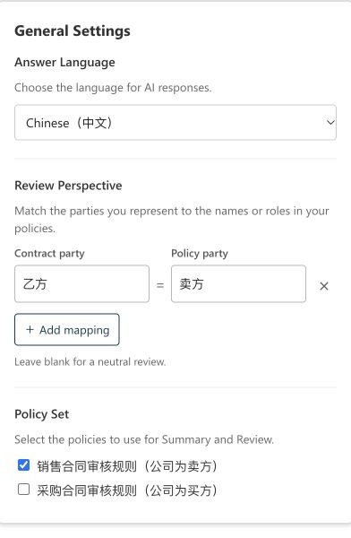

*图 4：以中文回答，将合同中的乙方对应到政策中的卖方，并选择销售合同审核规则。可通过 Add mapping 增加对应关系。*

### 4. 使用 Summary、Ask 和 Review

#### 4.1 Summary：先看合同全貌

1. 检查回答语言、审核立场，勾选适用的 Policy Set。
2. 点击 **Summarize Document**，等待完成。
3. 查看 **Document Summary**、**Key Points** 和 **Sections Summary List**。
4. 点击条目标题展开，查看 **Summary**、**Notes**、**Original Text** 和 **Key Items** 等内容。
5. 点击 **Go to** 尝试定位 Word 原文，并核对定位位置。
6. 修改合同或设置后，点击 **Run Summary Again** 重新生成。

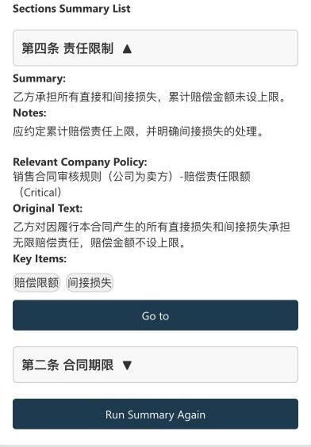

*图 5：展开责任限制条款，查看摘要、风险提示、规则集、规则名称和级别，再通过 Original Text 与 Go to 核对合同原文。*

Summary 读取当前 Word 正文全文，结合选定规则和审核立场生成结果，不会直接修改 Word 文档。除规则符合情况外，也应展示重要的一般性合同风险；没有匹配 Policy 的条目仍会保留，只是不附公司规则引用。结果中的合同事实、公司规则和修改建议需要分别理解，引用内容应回到原文核对。

Summary、Review 的正式规则引用显示规则集、规则名称及级别。后台会将分析正文中与已核实规则编号对应的“公司政策 2”等称呼改为不带序号的表述，不影响该引用区块。

#### 4.2 Ask：围绕当前合同提问

在问题框输入问题，点击 **Ask on the contract**。例如：

- “合同约定的付款条件是什么？请引用相关原文。”
- “按照当前审核立场，提前解除合同有哪些影响？”
- “甲方的验收义务出现在哪些条款中？”

Ask 自动读取当前合同。点击 **Relevant Clauses** 中的相关条款定位原文并核对；点击 **Answer** 标题折叠或展开回答。需要继续提问时，点击 **Search Again**。

Ask 不会修改文档。**每次提问是独立请求，不会发送之前的问答历史**，因此下一次问题需要写明必要背景，不要只写“那这一条呢”。当前 Ask 不读取你的 Policy 库，不能把它的回答当作已经完成公司规则检查。

#### 4.3 Review：检查选中的条款

1. 检查回答语言、审核立场，并勾选适用的 Policy Set。
2. 在 Word 中选中需要审核的完整条款，尽量包含必要的限定条件。
3. 点击 **Review**。没有选中文字时，插件会提示先选择文本。
4. 点击结果卡片标题展开，查看分析、Policy 引用和修改理由。
5. 出现多个改写方案时，用 **◀ / ▶** 切换并比较。
6. 审核下一段时，先在 Word 中选择新条款，再点击 **Review Next**。

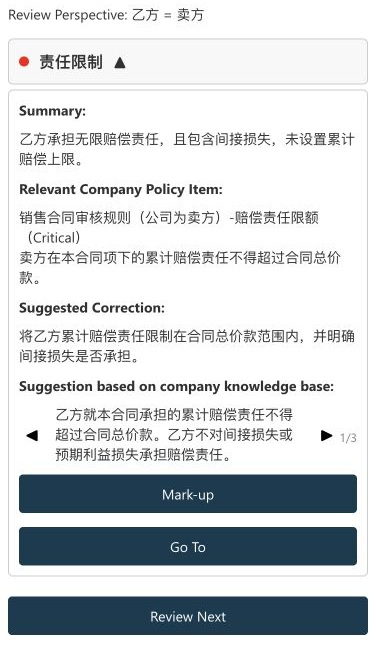

*图 6：责任限制条款的演示审核结果，展示政策依据及第 1 个改写方案（共 3 个）；使用箭头切换比较。*

Review 的审核目标是选中的条款，同时会读取合同全文，帮助识别主体、简称和上下文。运行前须选择 Policy Set；如果所选规则中没有适用于该条款的规则，仍会分析一般性合同风险，并以 **Review Basis** 标明没有匹配的公司政策。单次 Review 不代表已经逐条审查整份合同。

需要修改时，提示词要求三个修改方案都包含完整选区，只修改必要内容，并检查修改后的前后一致性；没有明显问题时，不强行提供改写。这是对模型的生成要求；采用前仍需核对是否遗漏原文、扩大修改范围或留下矛盾表述。

#### 4.4 Mark-up：把选定方案写回 Word

**Mark-up 会直接替换点击时 Word 当前选中的文字。** 它不是只添加一条评论，也不会自动开启 Word 的修订功能。

1. 阅读当前改写方案，核对金额、期限、主体、责任和语言。
2. 希望记录修改痕迹时，先在 Word 中开启“修订 / Track Changes”。
3. 点击结果中的 **Go To** 定位条款，然后目视确认 Word 中选中的确实是要替换的文字。遇到重复条款或很长的段落，尤其需要核对。
4. 确认选区和当前方案后，点击 **Mark-up**。
5. 回到 Word 检查替换结果；需要恢复时使用 Word 的“撤销”。

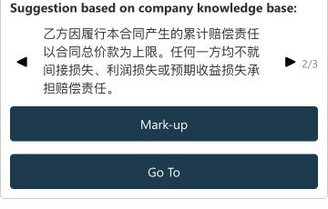

*图 7：切换至第 2 个方案，核对后点击 Mark-up，将当前方案应用到 Word 选区。需要保留修改痕迹时，先在 Word 开启“修订”。*

从生成建议到点击 Mark-up 之间，如果修改了正文、规则或设置，应先重新 Review。不要把旧方案直接应用到新的选区。

#### 4.5 保存结果与清理缓存

当前没有结果一键导出按钮。需要保存回答或分析时，可以选中面板中的文字，使用常规复制、粘贴，保存到自己的工作记录。

**Clear Cache** 只清除临时摘要和用户信息缓存，不会删除 Policy、模型配置、本地合同索引或全部缓存文件，也不会清空面板中所有已有结果。

### 5. 建立自己的 Policy 库

进入 **Config → Company Policies**。

本项目内置 **两组示例规则集（Policy Set），共六条规则（Policy）**：`销售合同审核规则（公司为卖方）` 和 `采购合同审核规则（公司为买方）`，每组各三条，便于首次使用时测试。正式使用时，应根据自己的审核要求配置。

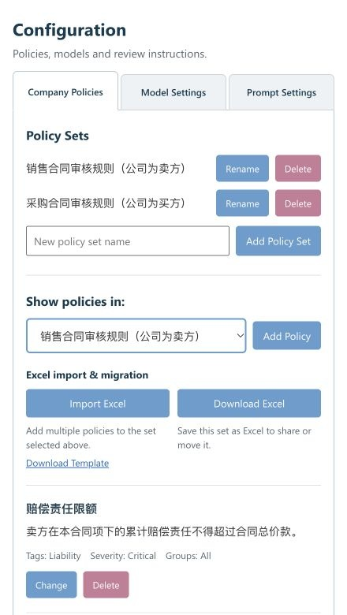

*图 8：在 Show policies in 中选择销售合同审核规则，通过 Change 修改规则，也可导入 Excel、下载模板或导出当前规则集。*

#### 新建规则集

1. 在 **New policy set name** 中填写名称。
2. 点击 **Add Policy Set**。
3. 在 **Show policies in:** 下拉框中选择该规则集，查看或添加其中的规则。

**Show policies in:** 只是配置页的查看筛选。真正用于某次审核的规则集，需要回到审核面板，在 **General Settings → Policy Set** 中勾选。

#### 添加、修改规则

点击 **Add Policy** 添加一条规则；修改现有规则时点击对应卡片上的 **Change**。

| 字段 | 填写内容 |
| --- | --- |
| **Policy title** | 简短、明确的规则名称 |
| **Policy instruction** | 需要检查的条件，以及不满足时希望提示或建议什么 |
| **Tags (comma-separated)** | 可选关键词，用英文逗号分隔 |
| **Permission groups (comma-separated; blank means all)** | 个人使用通常留空 |
| **Policy Set** | 该条规则所属的规则集 |
| **Severity** | `1 - Critical`、`2 - Warning` 或 `3 - Informational`；新规则默认 Warning |

填写后点击 **Save policy**；放弃本次编辑点击 **Cancel**。规则不会因为标题相同而自动合并，更新已有要求时优先使用 **Change**。

删除具体规则时，点击该规则的 **Delete**，核对弹窗中的名称后再次点击 **Delete**；点击 **Cancel** 则保留规则。

规则集旁也有 **Delete**，但只允许删除空规则集。有规则时，先通过 **Change → Policy Set** 将规则移动到其他集合，或逐条删除。删除空规则集并确认后，审核面板会移除对应复选框，其他规则集的勾选保留；全部删除后，需要先新建规则集再添加规则。

规则尽量说明适用场景和具体检查要求。新增或修改规则后，注意在保存后，回到审核面板，确认相应 Policy Set 已勾选，再重新运行 Summary 或 Review。调整规则不会自动重写已经生成的结果。

### 6. 用 Excel 分享与迁移规则

#### 下载一个规则集

在 **Config → Company Policies** 的 **Show policies in:** 中选择需要分享的 Policy Set，点击 **Download Excel**。下载文件只包含该规则集中的规则，可用 Excel 打开或交给另一台电脑导入。

Excel 模板和下载文件使用英文列名，保留政策名称、审核要求、Severity、标签和 Groups。后两列选填，没有值时留空。规则 ID 会在导入端重新生成，Excel 不包含合同、模型配置或 API Key。

#### 批量导入当前规则集

1. 选择目标 Policy Set；没有目标规则集时，先用 **Add Policy Set** 新建。
2. 点击 **Import Excel** 下方的 **Download Template**。模板的 **Policies** 工作表用于填规则，**Instructions** 工作表提供英文说明和示例；示例不会自动导入。
3. 每行填写一条规则，保存为 `.xlsx`。文件上限 3 MB，每次最多导入 500 条；不支持旧版 `.xls`、宏文件或公式。规则超过 500 条时，请拆分后分批导入。
4. 展开 **Import Excel** 后点击 **Choose File** 选择文件；未选择时显示 **No file selected**。点击 **Preview**，核对目标规则集、每条内容、Severity、新增数量和重复或冲突提示。此时尚未保存。
5. 确认后点击 **Confirm import**。成功后，在规则列表核对内容，再回到审核面板勾选适用的 Policy Set，重新运行 Summary 或 Review。

| Excel 列 | 填写说明 |
| --- | --- |
| Policy Title | 必填，简短名称，最多 200 字符 |
| Policy Instruction | 必填，说明适用条件和检查要求，最多 16,000 字符 |
| Severity | 必填，使用下拉选项 `Critical`、`Warning`、`Informational`；也接受 `1`、`2`、`3` |
| Tags (optional) | 多个标签用英文或中文逗号分隔，可留空 |
| Groups (optional) | 可留空；有原值时迁移保留。当前本地版根据 Policy Set 选用规则，Groups 作为兼容字段保留，不用于访问控制 |

**导入只新增，不会覆盖或删除原有规则。** 同一目标规则集内，名称、要求、Severity、标签及权限组一致的规则会跳过；同名但内容或相关字段不同的规则会提示冲突，整次导入暂不保存。需要更新原规则时，使用 **Change**；需要保留为新规则时，先在 Excel 修改名称。表中任何一条规则不合格，都会提示修正后再上传，不会只导入其中一部分。

Excel 不需要填写 Policy Set 列：目标由配置页当前选择决定。导入预览后若规则库发生变化，需再次 Preview。下载或导入不调用 AI 模型。

### 7. 配置三个功能的提示词

打开 **Config → Prompt Settings**，选择 **Ask、Summary 或 Review**，查看或编辑该功能的 **Core prompt**。直接使用默认提示词也可以运行。

修改后点击 **Save Prompt**，下次运行对应功能时生效，无需重启；点击 **Restore Default** 只恢复当前功能。关闭或刷新页面前请保存。

保留默认提示词中的输出字段名称。合同、回答语言、审核立场和必要的引用规则由插件自动补充；已选政策仅用于 Summary 和 Review，无需手工粘贴。

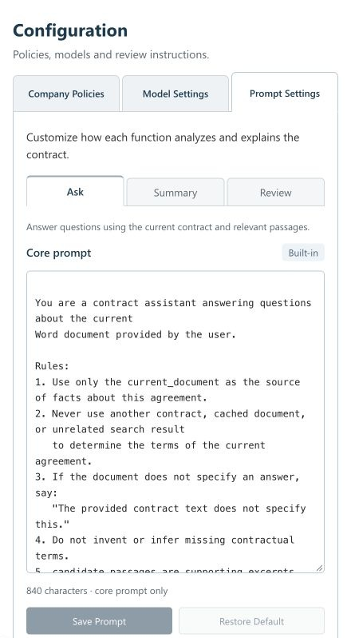

*图 9：选择功能书签编辑 Core prompt，再用 Save Prompt 保存或 Restore Default 恢复内置提示词。*

### 8. 数据存放和模型调用

本地版的 Policy 和模型配置保存在本机。点击功能后，相关文本会发送给你配置的模型服务：

> **API Key 以明文保存在项目主目录的 `model_config.json` 中。** 该文件不会随源码或安装包发布，但**任何能读取这个文件夹的人都能读到你的 Key**。请不要把整个项目文件夹压缩发送、上传网盘或提交到代码仓库；建议使用单独申请、带额度限制的 Key，并在不再使用时到模型服务商处吊销。当前版本尚未加密存储，后续版本会改为系统凭据存储。

合同分块、原编号和位置信息保存在项目主目录的 `.ally-contract-index` 文件夹，Ask 的合同向量缓存保存在 `.ally-vector-cache`。这些文件可能包含合同内容，不要随开源代码或 Policy 分享。它们用于复用检索准备结果，不是可供恢复的合同历史版本。

| 功能 | 发送给 Chat Model 的主要内容 |
| --- | --- |
| Ask | 问题、当前合同全文、相关段落、审核立场 |
| Summary | 当前合同全文、选定规则、审核立场 |
| Review | 选中条款、合同全文、检索到的规则、审核立场 |

Embedding Model 也会处理文本：Ask 会发送问题，合同分块的向量在没有可用缓存时生成，已有且匹配当前合同和向量模型的缓存会复用；Review 会发送选中条款，并在建立或更新规则检索缓存时处理 Policy 文本。Summary 不调用向量模型。**当前规则向量缓存可能涉及本地全部 Policy，不仅是本次勾选规则集中的条目。**

因此，“个人本地使用”不等于“模型完全离线”。合同和规则是否离开电脑，取决于你配置的模型服务地址。更换模型或分享规则前，应先确认所用服务和分享内容符合自己的使用要求。
